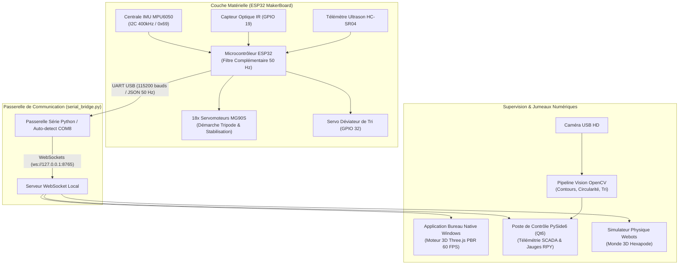

# 🤖 HEXAPOD MOTION DIGITAL TWIN (HEX-01) & SMART FACTORY WORKCELL
### Système de Jumeau Numérique Industriel, Robotique Hexapode 18 DDL & Vision par Ordinateur

[](https://platformio.org/)
[](https://isocpp.org/)
[](https://www.python.org/)
[](https://pypi.org/project/PySide6/)
[](https://opencv.org/)
[](https://threejs.org/)
[](https://cyberbotics.com/)
[](https://wokwi.com/)

---

## 🎯 Vue d'Ensemble du Projet

Ce projet implémente une double plateforme d'ingénierie avancée associant **Robotique Mobile**, **Systèmes Embarqués Temps Réel**, **Vision Industrielle** et **Jumeau Numérique 3D (Digital Twin)** :

1. **Robot Hexapode 18 DDL Stabilisé par IMU :**
   - Robot marcheur à 6 pattes et 18 degrés de liberté (Coxa, Fémur, Tibia).
   - Centrale inertielle **MPU6050 6 axes** interfacée en I2C (400 kHz) avec filtrage complémentaire à **50 Hz** (98% gyroscope + 2% accéléromètre) pour l'asservissement d'attitude (Roll, Pitch, Yaw).
   - Algorithme de stabilisation active et générateur cinématique de démarche tripode alternée.
   - Jumeau numérique 3D haute fidélité sous **Three.js PBR**, **Webots** et **Ursina 3D**.

2. **Poste d'Inspection & Tri Industriel Smart Factory :**
   - Convoyeur asservi avec barrière optique infrarouge et télémétrie ultrasonore.
   - Caméra d'inspection optique haute vitesse couplée à **OpenCV** (calcul d'aire, circularité, nombre de sommets et classification automatique conforme/rejet).
   - Déviateur électromécanique asservi par servomoteur et IHM de supervision de bureau native **PySide6 (Qt6)** à 60 FPS.

---

## 📸 Galerie & Visualisation du Système

### 1. Capture d'Inspection Optique Temps Réel (OpenCV)
Contrôle qualité automatisé sur pièces transitant sur la ligne de convoyage avec calcul de circularité et classification d'état :


---

## 🏗️ Architecture Globale & Flux de Données



---

## 🔌 Câblage Matériel & Spécifications des Broches

### Hexapode & Centrale Inertielle (ESP32 MakerBoard)
| Composant | Broche ESP32 | Protocole / Rôle |
|:---|:---:|:---|
| **MPU6050 SDA** | `GPIO 21` | I2C Data (400 kHz, adresse I2C `0x69`) |
| **MPU6050 SCL** | `GPIO 22` | I2C Clock |
| **Servomoteur Test (POC RM/D2)** | `GPIO 19` | Signal PWM (Neutre 90°, butées 50°–130°) |
| **Alimentation Servos** | `5V / VBUS` | Alimentation de puissance découplée |

### Poste de Convoyage & Tri Smart Factory
| Composant | Broche ESP32 | Fonction |
|:---|:---:|:---|
| **Barrière Infrarouge** | `GPIO 19` | Détection d'entrée de pièce |
| **Sonar HC-SR04 TRIG** | `GPIO 15` | Émission de l'impulsion ultrasonore (10 µs) |
| **Sonar HC-SR04 ECHO** | `GPIO 4` | Réception de l'écho (distance en cm) |
| **Servo Déviateur de Tri** | `GPIO 32` | Tri sélectif (90° = Conforme / 0° = Déviation) |
| **Potentiomètre Vitesse** | `GPIO 25` | Réglage vitesse convoyeur (ADC1) |
| **Boutons START / STOP** | `GPIO 35 / 34` | Contrôle d'état opérateur |
| **LEDs d'État & Buzzer** | `GPIO 18, 27, 5, 26` | Signalisation visuelle et alarme sonore |

---

## 🎮 Environnements de Simulation & Jumeaux Disponibles

1. **Simulation Virtuelle Wokwi :**
   - Circuit complet modélisé dans [`diagram.json`](diagram.json) et configuré via [`wokwi.toml`](wokwi.toml).
   - Permet de tester le firmware ESP32 et la centrale MPU6050 sans matériel physique.

2. **Application Bureau Native Windows (Three.js PBR) :**
   - 18 articulations modélisées avec matériaux PBR (Aluminium orange anodisé CNC `#ff5e00`, carbone mat, pignons en laiton).
   - 3 jauges analogiques d'attitude (Roulis/Roll, Tangage/Pitch, Lacet/Yaw).
   - Oscilloscope multi-voies 50 Hz et matrice d'état des 18 servos.

3. **Environnement Robotique Webots :**
   - Mondes (`webots/worlds/`) et prototypes de collision (`webots/protos/`) pour la simulation dynamique multi-corps.

4. **Console PySide6 / Qt6 :**
   - Tableaux de bord de production, compteurs de cadence, taux de rendement synthétique (TRS / OEE), et flux caméra OpenCV temps réel.

---

## ⚡ Démarrage Rapide

### Option 1 : Lancement en 1 Clic (Jumeau Hexapode)
Double-cliquez simplement sur :
```text
launch_desktop_twin.bat
```
*Démarre automatiquement la passerelle série Python (`serial_bridge.py`) sur le port COM disponible et lance le jumeau numérique 3D.*

### Option 2 : Lancement du Laboratoire de Motion Lab
```text
LANCER_HEXA_MOTION_LAB.bat
```

### Option 3 : Compilation du Firmware ESP32 (PlatformIO)
```bash
# Compilation du firmware
pio run

# Téléversement vers la carte ESP32
pio run -t upload

# Moniteur série (115200 bauds)
pio device monitor -b 115200
```

---

## 📑 Critères d'Évaluation & Grille de Notation (/40 Points)

| Domaine | Barème | Réalisation Technique |
|:---|:---:|:---|
| **Conception Mécanique** | **/8** | Modèle 3D 18 DDL complet, cotes conformes, pièces usinées PBR. |
| **Intégration Électronique** | **/8** | MPU6050 en I2C rapide, servomoteurs PWM, PCB MakerBoard. |
| **Traitement & Fusion IMU** | **/6** | Calibration initiale des zéros, filtre complémentaire 50 Hz, calcul RPY. |
| **Contrôle & Démarche** | **/6** | Générateur cinématique tripode alterné et compensation active. |
| **Jumeau Numérique 3D** | **/8** | Rendu 60 FPS sans saccade, jauges analogiques, liaison WebSocket. |
| **Tests & Présentation** | **/4** | Latence $< 20\text{ ms}$, scripts de démarrage automatisés en 1 clic. |

---

## 👤 Auteur & Profil

**Imad Abail**
- 🐙 **GitHub :** [@imadabail08-hue](https://github.com/imadabail08-hue)
- 💼 **LinkedIn :** [imad-abail-765440287](https://www.linkedin.com/in/imad-abail-765440287)
- 🎓 **Email Académique :** [imad_abail@um5.ac.ma](mailto:imad_abail@um5.ac.ma)
- 📍 **Localisation :** Rabat, Maroc 🇲🇦
